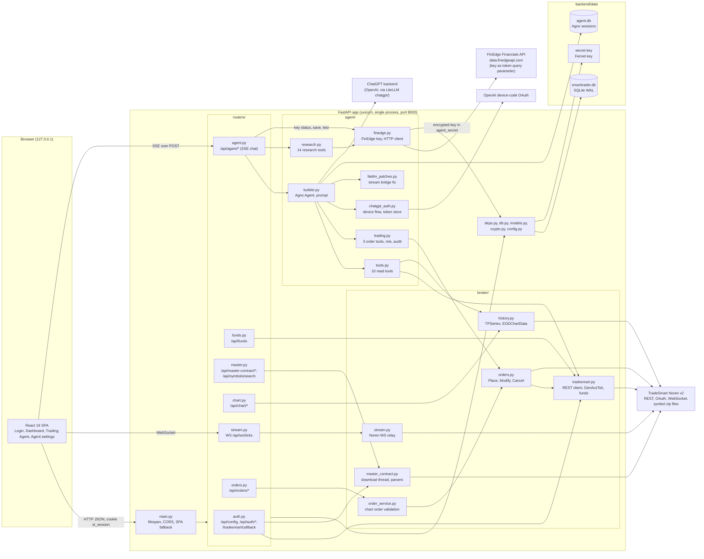
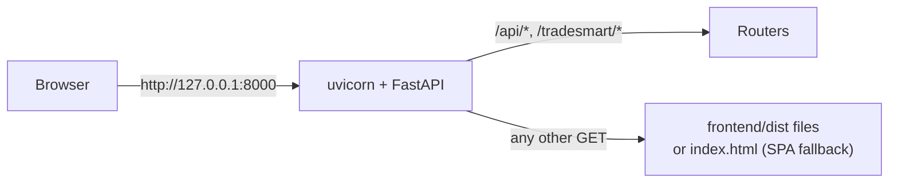
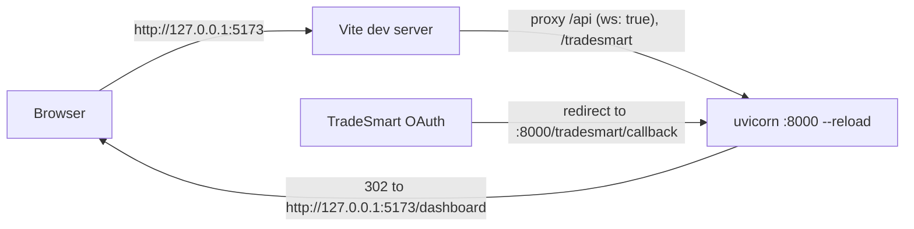

# SmartTrader Technical Design

This folder is the technical design of SmartTrader as it exists in the code today.
The code is the source of truth. Where the code and `SPEC.md` disagree, these
documents describe the code and list the difference (see the "Spec discrepancies"
section of each file and the summary in [risks.md](risks.md)).

| Document | Contents |
| --- | --- |
| [README.md](README.md) | Architecture overview, component diagram, tech stack, process and port model, configuration |
| [backend.md](backend.md) | Module responsibilities, dependency injection, lifecycle, background work, concurrency, errors and logging |
| [flows.md](flows.md) | Sequence diagrams for login, master contract, funds, charts, live ticks, orders, the agent chat turn, a research report turn and saving the FinEdge key |
| [agent.md](agent.md) | The AI agent: model and provider, prompt rules, read, research and order tools, guardrails, persistence |
| [frontend.md](frontend.md) | Pages, routing, state, theming and components (reconstructed from the build) |
| [security.md](security.md) | Secrets, encryption, session cookie, CSRF and CORS, broker token and FinEdge key handling, agent order safety, third-party data flows, threat notes |
| [risks.md](risks.md) | Known gaps, technical debt and recommendations |

## 1. What the system is

SmartTrader is a single-user, locally hosted trading application for TradeSmart
Online (Noren v2 API). One person runs it on their own machine at
`http://127.0.0.1:8000`. It provides:

- Broker login through the TradeSmart OAuth page, with the API key, encrypted API
  secret and redirect URL stored in SQLite (no `.env` files).
- Automatic download of the master contract (symbol master, about 1.7 lakh rows
  across NSE, BSE, NFO, BFO, CDS and MCX) after login.
- A dashboard with funds, master contract status and symbol search.
- A charting page (OpenAlgo Charts engine) with history, live ticks relayed from the
  broker WebSocket, and chart trading (place, modify, cancel, close position).
- An AI agent (Agno plus LiteLLM, using a ChatGPT subscription) that reads account
  and market data through tools and, when explicitly enabled, can propose orders
  that the user must approve in the UI before anything is sent.
- Fundamental research in the agent (company reports, comparisons, buy or sell views
  with a medium or long term horizon) through the FinEdge Financials API, enabled
  when the user saves a FinEdge API key on the Agent settings page.

## 2. Component diagram



Key properties:

- One process holds all state that matters: the SQLite files, the in-memory agent run
  registry, the master contract download lock, the ChatGPT sign-in flow and the
  FinEdge response cache. The
  design assumes exactly one uvicorn worker.
- The browser never receives the TradeSmart API secret, the broker access token,
  the ChatGPT OAuth tokens or the FinEdge API key (only a masked form with the last
  4 characters). All broker, LLM and FinEdge calls are made server side.
- FinEdge is an optional third external system: without a saved key the research
  tools are not attached and the agent works as before.
- The broker WebSocket is opened by the backend per browser tick socket and only
  price and volume are forwarded.

## 3. Tech stack and versions

Backend (`backend/pyproject.toml`, resolved versions from `backend/uv.lock`):

| Component | Constraint | Locked version | Role |
| --- | --- | --- | --- |
| Python | `>=3.14` (`.python-version` 3.14) | 3.14 | Runtime |
| uv | | 0.12.5 (venv creator) | Environment and dependency manager, `package = false` |
| FastAPI | `==0.143.0` | 0.143.0 | HTTP, WebSocket and SSE framework |
| Starlette | (transitive) | 1.7.0 | ASGI toolkit under FastAPI |
| uvicorn[standard] | `==0.54.0` | 0.54.0 | ASGI server |
| Pydantic | (transitive) | 2.14.0 | Request validation |
| SQLAlchemy | `>=2,<3` | 2.1.4 | ORM and engine for SQLite |
| greenlet | `>=3.5.6` | 3.5.6 | SQLAlchemy dependency |
| httpx | `>=0.28.1` | 0.28.1 | Sync REST client to TradeSmart and FinEdge |
| websockets | `>=17.2` | 17.2 | Client socket to the Noren WebSocket |
| cryptography | `>=50.0.2` | 50.0.2 | Fernet encryption at rest |
| agno | `>=3.1.2` | 3.1.2 | Agent framework (runs, tools, pause and resume, SQLite session store) |
| litellm | `>=1.104.2` | 1.104.2 | Model access through the `chatgpt/` provider |
| openai | (transitive) | 2.54.0 | Used by LiteLLM |
| tzdata | `>=2026.5` | 2026.5 | Time zone data (Asia/Kolkata) on Windows |
| pytest (dev) | `>=9.1.1` | 9.1.1 | Tests (86 test functions in `backend/tests`) |

Frontend (`frontend/package.json`, resolved versions from `frontend/package-lock.json`):

| Component | Constraint | Locked version | Role |
| --- | --- | --- | --- |
| react, react-dom | `^19.3.0` | 19.3.0 | UI |
| react-router | `^7.18.4` | 7.18.4 | Client routing |
| @tanstack/react-query | `^5.104.1` | 5.104.1 | Server state, polling, cache |
| openalgo-charts | `^2.6.0` | 2.6.0 | Chart engine, indicators, drawing tools, trading lines |
| react-markdown, remark-gfm | `^10.1.0`, `^4.0.1` | 10.1.0, 4.0.1 | Agent answer rendering |
| class-variance-authority, clsx, tailwind-merge | `^0.7.1`, `^2.1.1`, `^3.7.0` | same | Component variant styling |
| tailwindcss, @tailwindcss/vite | `^4.3.3` | 4.3.3 | Styling |
| vite | `^8.3.4` | 8.3.4 | Dev server and bundler |
| @vitejs/plugin-react | `^6.1.2` | 6.1.2 | React transform |
| typescript | `^7.0.2` | 7.0.2 | Type checking (`tsc -p .` before `vite build`) |
| Node | | 24 (README) | Tooling runtime |

Note: `frontend/src` contains only empty folders, so the frontend cannot be rebuilt
from this repository. See [frontend.md](frontend.md) and [risks.md](risks.md).

## 4. Process and port model

### 4.1 Single port (production style, recommended)



- This checkout serves the existing `frontend/dist`; source recovery is required
  before `npm run build` can be used. Do not delete or rebuild the supplied bundle.
  The backend serves it from the catch-all
  route `GET /{full_path:path}` registered last in `main.py`.
- The fallback returns 404 for `api`, `api/*` and `tradesmart/*` paths, serves a real
  file inside `dist` if one exists (with a `is_relative_to` check against path
  traversal), and otherwise returns `index.html`.
- The presence of `frontend/dist/index.html` is checked per request, so a build made
  after the server started is picked up without a restart.
- After the OAuth callback the backend redirects relatively (`/dashboard` or
  `/login?error=...`) because it serves the UI itself.

Start command. In this checkout the virtual environment was copied from another folder and its
`uvicorn.exe` launcher still points at the old interpreter path, so the working
command is:

```
cd backend
uv run python -m uvicorn app.main:app --host 127.0.0.1 --port 8000 --workers 1
```

### 4.2 Development mode (two ports)

This describes the configured workflow after frontend source is recovered. It is
not usable with the empty `frontend/src` in this checkout. Keep the supplied build
and use backend reload on port 8000 in the meantime.



- Vite (`vite.config.ts`) listens on `127.0.0.1:5173` with `strictPort`, and proxies
  `/api` (including the tick WebSocket) and `/tradesmart` to `http://127.0.0.1:8000`
  without changing the Origin.
- The OAuth redirect URL registered with TradeSmart still points at port 8000. When
  `frontend/dist/index.html` does not exist, `config.frontend_url()` returns
  `http://127.0.0.1:5173` (or `SMARTTRADER_FRONTEND_URL`), so the callback redirects
  the browser to the Vite server.
- The session cookie is host-only on `127.0.0.1` without a port, so it is sent to both
  ports. `localhost` and `127.0.0.1` are different hosts for cookies, so the app must
  be opened on `127.0.0.1`.
- Caveat: if `frontend/dist/index.html` exists, the callback sends the browser to
  port 8000 even in dev mode; `SMARTTRADER_FRONTEND_URL` does not override that.
- `vite preview` is configured on port 4173 without a proxy, and 4173 is not in the
  CORS list, so preview mode cannot reach the API.

## 5. Configuration

There is no settings file and no `.env`. `backend/app/config.py` holds paths and
constants; secrets live in SQLite (encrypted) and in `data/secret.key`. This includes
the FinEdge API key: it is entered on the Agent settings page and stored encrypted
in `agent_secret`; it is never read from `.env` or an environment variable.

| Name | Value | Purpose |
| --- | --- | --- |
| `BACKEND_DIR` | parent of `app/` | Base path |
| `DATA_DIR` | `backend/data` | Runtime data, created on start |
| `DB_PATH` | `data/smarttrader.db` | Main SQLite database |
| `SECRET_KEY_PATH` | `data/secret.key` | Fernet key, generated on first start |
| `TMP_DIR` | `data/tmp` | Master contract work directories |
| `FRONTEND_DIST` | `frontend/dist` | Built SPA served at `/` |
| `DEV_FRONTEND_URL` | `http://127.0.0.1:5173` | Post-callback redirect base when no build exists |
| `FRONTEND_URL_ENV` | `SMARTTRADER_FRONTEND_URL` | Environment variable overriding the dev URL (not a secret) |
| `TRADESMART_HOST` | `https://v2api.tradesmartonline.in` | Broker host, also hosts `<EXCH>_symbols.txt.zip` |
| `REST_ROOT` | `<host>/NorenWClientAPIv2` | Authenticated REST endpoints |
| `GENACSTOK_URL` | `<REST_ROOT>/GenAcsTok` | Code to token exchange |
| `AUTHORIZE_URL` | `<host>/OAuthlogin/authorize/oauth` | Broker login page |
| `STREAM_URL` | `wss://v2api.tradesmartonline.in/NorenWSAPI/` | Market data WebSocket |
| `USER_AGENT` | desktop Chrome string | Needed because the hosts sit behind Cloudflare |
| `API_TIMEOUT` | 20 s | REST timeout |
| `DOWNLOAD_CONNECT_TIMEOUT`, `DOWNLOAD_READ_TIMEOUT` | 15 s, 120 s | Symbol zip downloads |
| `SESSION_COOKIE` | `st_session` | Session cookie name |
| `CORS_ORIGINS` | `http://127.0.0.1:5173`, `http://localhost:5173` | Allowed credentialed origins (also used by the WS Origin check) |
| `IST` | UTC+05:30 | Display time zone |

Other configuration points in code:

- `agent/builder.py`: `AGENT_DB_PATH = data/agent.db`, `DEFAULT_MODEL = "gpt-5.5"`,
  reasoning efforts `low`, `medium`, `high`, history of 8 runs, 20 tool calls per turn
  (40 when a FinEdge key is saved).
- `agent/finedge.py`: `BASE_URL = https://data.finedgeapi.com`, 30 s timeout, two
  retries after 1 s and 2 s for 429 and 5xx, key test symbols `ITC` and `TCS`.
- `agent/research.py`: symbol list cache 24 h, index feed cache 15 min, at most 6
  companies per comparison, 20 symbols per quote call.
- `agent/chatgpt_auth.py`: defaults `CHATGPT_TOKEN_DIR` to `data/chatgpt`; an existing
  environment value is preserved. The installed authenticator overrides store
  tokens in SQLite. Login flow timeout is 15 minutes.
- `agent/trading.py` and `models.AgentRisk`: risk defaults (trading off, max order
  value 50,000 INR, max quantity 500, 20 agent orders per day, exchanges NSE and BSE,
  duplicate window 60 s). These are edited at runtime from Agent settings.
- `routers/agent.py`: max chat message 16,000 characters, tool result preview 4,000
  characters in the transcript.
- `broker/master_contract.py`: exchanges list, 10,000-row insert batches, 512 MB cap
  on an extracted symbols file.
- Database user settings live in tables: `broker_config` (API key, encrypted secret,
  redirect URL), `agent_setting` (model, effort, extra instructions), `agent_risk`.

## 6. Data stores at a glance

| Store | Owner | Contents |
| --- | --- | --- |
| `data/smarttrader.db` (WAL) | SQLAlchemy models in `models.py` | `broker_config`, `auth_session`, `symtoken`, `master_contract_status`, `agent_setting`, `agent_secret`, `agent_conversation`, `agent_message`, `agent_risk`, `agent_order_audit` |
| `data/agent.db` | Agno `SqliteDb` | Agno sessions and runs (model context, paused run state) keyed by conversation id |
| `data/secret.key` | `crypto.py` | Fernet key for `api_secret_enc`, `access_token_enc`, `agent_secret.value_enc` (ChatGPT tokens and the FinEdge key) |
| Browser `localStorage` | SPA | Theme, chart layout, drawings, indicators, side rail state (no secrets) |

The full table definitions are documented separately in `docs/schema`.
