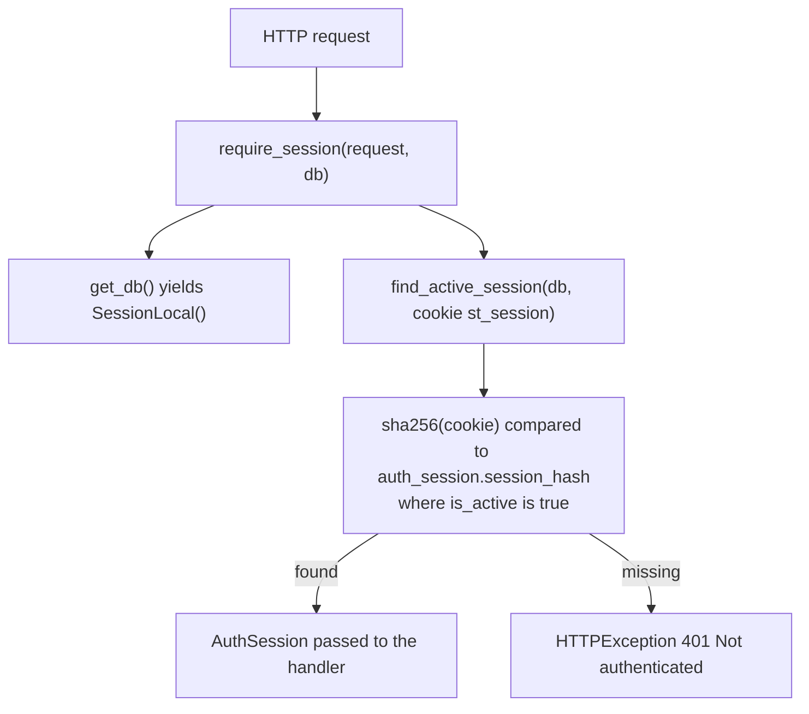
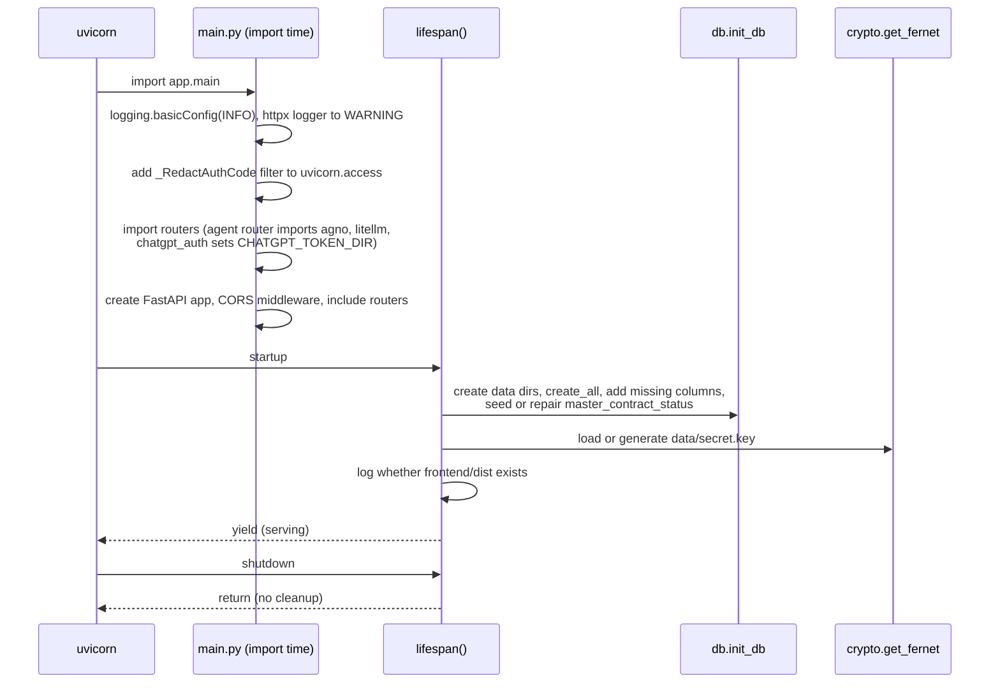

# Backend Design

The backend is a FastAPI application in `backend/app`, run by uvicorn as a single
process. It talks to SQLite through SQLAlchemy 2, to TradeSmart through httpx (REST)
and websockets (market data), to the ChatGPT backend through Agno and LiteLLM, and,
when a key is saved, to the FinEdge Financials API through httpx.

## 1. Package layout

```
backend/app/
  main.py            app object, logging, lifespan, CORS, router wiring, SPA fallback
  config.py          paths, URLs, timeouts, cookie name, CORS origins, time helpers
  db.py              engine, SQLite pragmas, SessionLocal, init_db, light migration
  models.py          ORM tables
  crypto.py          Fernet key management, encrypt, decrypt
  deps.py            get_db, session cookie lookup, require_session
  routers/
    auth.py          /api/config, /api/auth/login|session|logout, /tradesmart/callback
    funds.py         /api/funds
    master.py        /api/master-contract/status|download, /api/symbols/search
    chart.py         /api/chart/intervals, /api/chart/history
    stream.py        WS /api/ws/ticks
    orders.py        /api/orders, /{id}/modify, /{id}/cancel, /close-position, /symbol
    agent.py         /api/agent/* (settings, FinEdge key, ChatGPT sign-in, conversations, SSE chat, risk, audit)
  broker/
    tradesmart.py    REST client core, checksum, GenAcsTok, post_authenticated, funds
    history.py       candles via TPSeries and EODChartData, interval table, volume repair
    master_contract.py  symbol master download, parse, store, status, background thread
    stream.py        Noren WebSocket relay for one browser socket
    orders.py        PlaceOrder, ModifyOrder, CancelOrder, OrderBook lookup, price protection
    order_service.py chart trading: validation, LTP lookup, protected prices, symbol state
  agent/
    builder.py       Agno Agent factory, system prompt, research rules, model list
    tools.py         ten read-only tools bound to the user's broker session
    finedge.py       FinEdge API key (encrypted in agent_secret), HTTP client, key test, small cache
    research.py      fourteen fundamental research tools bound to the FinEdge key
    trading.py       three confirmation-gated order tools, risk settings, audit trail
    chatgpt_auth.py  ChatGPT device-code sign-in and encrypted token storage for LiteLLM
    litellm_patches.py  repair for missing tool-call arguments in LiteLLM's stream bridge
```

## 2. Module responsibilities

### 2.1 Core

| Module | Responsibility | Notes |
| --- | --- | --- |
| `main.py` | Configures logging, creates `FastAPI(title="SmartTrader", version="0.1.0")`, installs `CORSMiddleware`, includes the seven routers, defines `GET /api/health` and the SPA fallback, which serves `frontend/dist` files with `Cache-Control: no-cache` so in-place patched chunks are revalidated. | The fallback is registered last so every API route wins. |
| `config.py` | Constants (see [README.md](README.md) section 5), `ensure_data_dirs()`, `frontend_url()`, `utcnow()` (naive UTC for storage), `to_ist_iso()` and `now_ist_iso()` for output. | All timestamps are stored as naive UTC and rendered in IST. |
| `db.py` | Creates the engine on `data/smarttrader.db` with `check_same_thread=False` and a 30 s timeout. A `connect` listener sets `journal_mode=WAL`, `synchronous=NORMAL`, `busy_timeout=30000`. `SessionLocal` uses `autoflush=False, expire_on_commit=False`. `init_db()` runs `create_all`, adds missing columns listed in `_ADDED_COLUMNS` (currently `agent_message.pending_json`), seeds `master_contract_status` row 1, and flips a stale `downloading` status to `error` ("Previous download was interrupted"). | There is no migration tool; `_ADDED_COLUMNS` is a minimal additive migration. |
| `models.py` | Ten tables: `broker_config`, `auth_session`, `symtoken`, `master_contract_status`, `agent_setting`, `agent_secret`, `agent_conversation`, `agent_message`, `agent_risk`, `agent_order_audit`. | Single-row tables use `id=1`. |
| `crypto.py` | Loads or creates the Fernet key at `data/secret.key` with `O_EXCL` and mode 0600; caches one `Fernet` under a process-local lock. `encrypt()` returns ASCII; `decrypt()` returns `None` for missing values or Fernet `InvalidToken`. | A different valid key makes old ciphertext unreadable. A malformed key file can fail startup; other decode errors are not caught. |
| `deps.py` | `get_db()` yields a session per request; `hash_session_value()` is SHA-256 hex; `find_active_session()` looks up an active `auth_session` by cookie hash; `require_session()` raises 401 "Not authenticated". | See section 3. |

### 2.2 Routers

| Router | Endpoints | Auth | Main collaborators |
| --- | --- | --- | --- |
| `auth.py` | `GET /api/config`, `POST /api/auth/login`, `GET /tradesmart/callback`, `GET /api/auth/session`, `POST /api/auth/logout` | none (by design; these establish or report the session) | `tradesmart.generate_access_token`, `master_contract.start_download_in_background`, `crypto` |
| `funds.py` | `GET /api/funds` | `require_session` | `tradesmart.fetch_funds` |
| `master.py` | `GET /api/master-contract/status`, `POST /api/master-contract/download` (202 or 409), `GET /api/symbols/search` | router-level `require_session` | `master_contract`, `SymToken` queries (escaped LIKE, rank exact then prefix then others, limit 50) |
| `chart.py` | `GET /api/chart/intervals`, `GET /api/chart/history` | `require_session` | `history.fetch_history`, `SymToken` lookup |
| `stream.py` | `WS /api/ws/ticks` | Origin check, then cookie session | `broker.stream.relay_ticks`, threadpool DB lookups |
| `orders.py` | `GET /api/orders/symbol`, `POST /api/orders`, `POST /api/orders/{id}/modify`, `POST /api/orders/{id}/cancel`, `POST /api/orders/close-position` | `require_session` | `order_service` |
| `agent.py` | `/api/agent/status`, `/settings` (GET, PUT), `/finedge` (GET, PUT, DELETE), `/finedge/test` (POST), `/chatgpt/login` (POST, GET, DELETE), `/chatgpt/logout`, `/test`, `/conversations` (list, get, patch, delete), `/chat` (SSE), `/chat/confirm` (SSE), `/chat/{run_id}/cancel`, `/risk` (GET, PUT), `/orders/audit` | router-level `require_session` | `agent.builder`, `agent.tools`, `agent.research`, `agent.finedge`, `agent.trading`, `agent.chatgpt_auth` |

Endpoint contracts are documented in `docs/api`.

### 2.3 Broker layer

| Module | Responsibility |
| --- | --- |
| `tradesmart.py` | `BrokerError` and its subclass `SessionExpiredError`. `make_checksum()` = SHA-256 of `api_key + api_secret + code`. `build_authorize_url()`. `new_client()` builds an httpx client with the browser User-Agent and a 20 s timeout. `generate_access_token()` posts `jData={code, checksum}` as `text/plain` without a Bearer header; on `stat == "Ok"` picks `access_token` or `susertoken`, user id from `actid`, `uid` or `USERID`, name from `uname`. `post_authenticated()` posts `jData=<json>` with `Authorization: Bearer`, raising `SessionExpiredError` on HTTP 401 or an `emsg` containing "session expired", and `BrokerError` on non-JSON. `compute_funds()` and `fetch_funds()` implement the OpenAlgo funds formula over `Limits` and `PositionBook`. `to_float()` treats missing or non-finite values as 0. |
| `history.py` | `INTERVALS` maps `1m 3m 5m 10m 15m 30m 1h 2h D` to TPSeries minutes or `D`. `lookback_days()` picks default windows (7 days for 1m up to 3 years for D), max 5 years. `data_exchange()` maps `NSE_INDEX` and `BSE_INDEX` to `NSE` and `BSE`. `fetch_history()` calls `TPSeries` (intraday, by token) or `EODChartData` (daily, `EXCH:BRSYMBOL`). `parse_candles()` sorts, de-duplicates by time, drops all-zero rows, treats a "no data" Not_Ok as empty, and `_repair_intraday_volume()` clamps the broker's end-of-day volume glitch using the cumulative day volume. |
| `master_contract.py` | Port of the OpenAlgo TradeSmart master contract logic using `csv` instead of pandas. Per exchange parsers (`parse_nse`, `parse_bse` plus hard-coded SENSEX and BANKEX index rows, `parse_nfo`, `parse_cds` skipping tokens up to 100, `parse_mcx`, `parse_bfo`). Downloads `<EXCH>_symbols.txt.zip` for NSE, BSE, NFO, CDS, MCX, BFO into a temp dir under `data/tmp`, extracts only the expected member to a fixed name (zip-slip safe, 512 MB cap), parses, de-duplicates on `(token, exchange)`, then replaces the whole `symtoken` table in one transaction with 10,000-row batch inserts. One failing exchange is skipped; status is `error` only if nothing loaded. Progress messages are written to `master_contract_status`. |
| `stream.py` | `relay_ticks()` opens the Noren socket, sends `t=a` with the stored token, waits up to 15 s for the `ak` acknowledgement (accepts `Ok` or `OK`), then runs three asyncio tasks: browser reader (subscribe and unsubscribe), broker reader (filters `tk` and `tf` messages for the current instrument key, merges partial touchline updates with `merge_tick`), and a 30 s heartbeat `t=h`. Any task finishing ends the relay and cancels the others. Ticks carry the server clock, not the broker's last trade time. |
| `orders.py` | Field maps (`PRODUCTS`, `PRICE_TYPES`, `SIDES`), market price protection slabs (EQ and FUT 2, 1, 0.5 percent; options 5, 3, 2, 1 percent), `round_to_tick()` (buy rounds up, sell rounds down), `OrderRequest`, `place_payload()` (encodes `&` in the trading symbol, `ret=DAY`, `ordersource=API`, `remarks=smarttrader-agent`), `place_order()`, `modify_order()`, `cancel_order()`, `find_order()` over `OrderBook`. MARKET goes out as LMT and SL-M as SL-LMT because the broker rejects market orders from the API. |
| `order_service.py` | The chart trading service. `place()` validates exchange (NSE, BSE, NFO, BFO, CDS, MCX), side, product, price type, quantity, price and trigger presence, lot-size multiples, looks up the LTP with `GetQuotes`, computes the protected price for MARKET and SL-M, and sends. `modify()` reads the order book row, refuses orders not in `OPEN`, `TRIGGER_PENDING`, `PENDING`, and for stop orders moves the trigger while keeping the limit gap. `cancel()`. `symbol_state()` returns open orders and net positions for one instrument with lot size, tick size, multiplier and realized P&L for live chart P&L. Raises `OrderInputError` for user-facing validation errors. |

### 2.4 Agent layer

Described in [agent.md](agent.md). In short: `builder.py` makes an Agno `Agent` with
a LiteLLM `chatgpt/<model>` model and `data/agent.db` history; `tools.py` provides
ten read tools; `trading.py` provides three `requires_confirmation` order tools with a
second risk check and an audit table; `chatgpt_auth.py` drives the device-code login
and stores tokens encrypted; `litellm_patches.py` fixes a LiteLLM stream bug that
drops tool-call arguments.

| Module | Responsibility |
| --- | --- |
| `finedge.py` | The FinEdge API key and HTTP client. `read_key()`, `write_key()`, `clear_key()` on the `agent_secret` row `finedge_api_key` (Fernet). `mask()` and `key_status()` (`configured`, `masked_key` with the last 4 characters, `updated_at` in IST; never the key). `get(path, api_key, params)` uses one cached `httpx.Client` (base `https://data.finedgeapi.com`, 30 s), adds the key as the `token` query parameter, retries 429 and 5xx twice (1 s, 2 s) and raises `FinEdgeError(status_code, message)` with the key replaced by `***` and no URL. `path_symbol()` URL-encodes symbols such as `M&M`. `test_key()` probes company-profile `ITC` then `TCS` and reports coverage `all` or `sample`. `cached()` and `clear_cache()`: a process-memory TTL cache under a lock. |
| `research.py` | `build_research_tools(api_key)` returns 14 guarded closures (search, profile, statements, ratios, growth, quotes, price performance, valuation history, peers, comparison, shareholding, dividends and actions, announcements, index overview) that trim FinEdge payloads and convert units to Rs crore and percent. `compare_companies` fetches up to 6 companies in parallel threads; batch quotes fall back to one by one with 8 threads when FinEdge refuses a batch. `RESEARCH_TOOL_DESCRIPTIONS` holds the labels for the settings page. |
| `builder.py` (research) | `RESEARCH_RULES` or `RESEARCH_OFF_RULE` is added to the instructions from the `research` flag, and `tool_call_limit` is 40 with research on, 20 otherwise. |

`routers/agent.py` `_agent_for()` reads the key on each chat or confirm request and
appends the research tools when one is saved. See [agent.md](agent.md) sections 3.1,
4.2 and 4.4.

## 3. Dependency injection (`deps.py`)



- `get_db` is a generator dependency: one SQLAlchemy session per request, closed in
  `finally`. FastAPI caches dependencies per request, so a handler that declares both
  `require_session` and `get_db` gets the same session object, which lets it update
  the `AuthSession` row (for example to deactivate it on broker session expiry).
- `require_session` is applied per endpoint (`funds`, `chart`, `orders`) or per router
  (`master`, `agent` via `APIRouter(dependencies=[...])`).
- The WebSocket route cannot use `Depends` the same way for its long-lived work, so it
  calls `find_active_session` inside `run_in_threadpool` with a short-lived
  `SessionLocal()` and only keeps the user id and decrypted token in memory.
- Code that runs outside a request (master contract thread, agent tools, agent
  streaming) opens its own `SessionLocal()` or `SessionLocal.begin()` blocks.

## 4. Startup and shutdown lifecycle (`main.py`)



- Nothing runs after `yield`. Daemon threads (master contract download, ChatGPT login
  poller) are killed with the process. A download interrupted this way is detected on
  the next start by `init_db()` and marked as `error`.
- LiteLLM patches and the ChatGPT authenticator overrides are installed lazily on the
  first `build_agent()` or `start_login()` call (both are idempotent).
- The Agno `SqliteDb` for `agent.db` is created lazily and cached by `lru_cache`.

## 5. Background work

| Work | Mechanism | Started by | Concurrency control |
| --- | --- | --- | --- |
| Master contract download | `threading.Thread(name="master-contract-download", daemon=True)` | OAuth callback after a successful login, or `POST /api/master-contract/download` | Module-level `threading.Lock` acquired non-blocking; a second request gets 409 (route) or is skipped (callback). Status row is set to `downloading` before the thread starts so an immediate poll sees it. |
| ChatGPT device-code poll | `threading.Thread(name="chatgpt-login", daemon=True)` | `POST /api/agent/chatgpt/login` | Module-level `_flow` object under a lock; the identity check discards stale status updates only. Token writes occur before that check, so cancelled or superseded flows can still save tokens. |
| Tick relay | three asyncio tasks per browser WebSocket (browser reader, broker reader, heartbeat) | `WS /api/ws/ticks` | `asyncio.wait(FIRST_COMPLETED)`, then cancel and gather the rest. |
| Agent run | Agno `arun` or `acontinue_run` async generator consumed by a `StreamingResponse` | `POST /api/agent/chat`, `POST /api/agent/chat/confirm` | Process-local `_running` dict maps run id to the agent for `/chat/{run_id}/cancel`. Client disconnect is checked between events and cancels the run. |
| Agent tool calls | Agno runs sync tool functions with `asyncio.to_thread` | Model tool calls | Each tool opens its own DB session; broker calls are blocking httpx calls in that thread. Research tools may start their own short-lived `ThreadPoolExecutor` (up to 6 workers for `compare_companies`, 8 for one-by-one quotes). |
| FinEdge key test | `run_in_threadpool(finedge.test_key, key)` | `POST /api/agent/finedge/test` | Two sequential GETs; no lock. |

There is no scheduler, task queue or periodic job. Funds, order state and master
contract status are refreshed by frontend polling.

## 6. Concurrency model

- Sync route handlers (`def`) run in Starlette's threadpool (anyio worker threads).
  This covers all REST routes except the agent's `chatgpt/login` start, `test`,
  `chat`, `confirm` and `cancel`, which are `async def`. Blocking broker calls inside
  sync handlers therefore do not block the event loop.
- Async routes offload blocking work explicitly: the WebSocket route uses
  `run_in_threadpool` for session and symbol lookups; `chatgpt_login_start` uses it
  for the device-code request.
- Agent streaming runs on the event loop; `_stream_run` performs small synchronous
  SQLite writes (transcript, audit) directly on the loop. These are short but do
  block it briefly.
- SQLite is shared by all threads with `check_same_thread=False`. WAL mode lets reads
  continue while the master contract rewrite (delete plus about 1.7 lakh inserts) is
  in progress; `busy_timeout=30000` absorbs writer contention.
- Each broker REST call creates a new `httpx.Client` (no shared connection pool),
  except `fetch_funds`, which reuses one client for its two calls, and the master
  download, which uses one client for all six files. FinEdge calls share one
  process-wide `httpx.Client` (`lru_cache`).
- The FinEdge cache (`finedge._cache`) is guarded by a `threading.Lock`; two threads
  missing at the same moment may both load the list, which is harmless.
- All process-level state (`_download_lock`, `_running`, ChatGPT `_flow`, cached
  `Fernet`, LiteLLM monkey patches, FinEdge client and cache) is per process. Running more than one uvicorn
  worker would break 409 detection, run cancellation and the sign-in flow. The design
  requires `--workers 1` (the default).

## 7. Error handling

Exception mapping used by routers:

| Source | Exception | HTTP result |
| --- | --- | --- |
| Pydantic validation | `RequestValidationError` | 422 with FastAPI's `detail` list |
| Missing or inactive session | `require_session` | 401 "Not authenticated" |
| Broker says session expired or HTTP 401 | `SessionExpiredError` | Session row set `is_active=False`, then 401 "Session expired, please log in again" (funds, chart, orders) |
| Missing or invalid ciphertext under a valid Fernet key | `decrypt()` returns None | Funds, chart history and order routes deactivate the session and return 401. Agent chat/confirm return 401 without deactivation; WebSocket handshake closes 4401 without deactivation. |
| Broker rejected the request | `BrokerError` | 502 with the broker `emsg` (orders prefix it with "TradeSmart: ") |
| Network failure | `httpx.HTTPError` | 502 "Could not reach TradeSmart" (class name logged, not the URL) |
| Chart order validation | `OrderInputError` | 422 with a readable message |
| Unknown symbol for history | lookup miss | 404 |
| Master download already running | lock held | 409 |
| Agent not signed in to ChatGPT | `account_status()` | 409 "Sign in with ChatGPT in Agent settings first." |
| Agent approval not pending | state check | 409 |
| FinEdge key test with no saved key | `read_key()` is None | 409 "Save a FinEdge API key first." |
| FinEdge key body invalid (under 8 or over 256 characters, or whitespace) | Pydantic | 422 |
| FinEdge rejected the key (401 `ER006`) | `FinEdgeError.invalid_key` | 422 "FinEdge rejected the API key. Check it and try again." (never 401, because the SPA logs out on any 401) |
| FinEdge unreachable or other FinEdge error | `FinEdgeError` | 502 "FinEdge is unreachable. Try again in a minute." or "FinEdge error (status): text" with the key masked |
| Provider failures in chat | any exception or `RunError` | SSE `error` frame with a friendly message from `_provider_message()`, then `done` with reason `error` |

The OAuth callback never returns an error body; every failure becomes a 302 to
`/login?error=<message>` (message truncated to 300 characters).

The tick WebSocket closes with 4403 for a foreign Origin (before accept, so the
browser sees an HTTP 403), and 4401 when credentials are unavailable (after accept,
so the browser can stop reconnecting). A `StreamError` sends `status: error` before
closing 1011; the separate `websockets.ConnectionClosed` handler closes 1011 without
that status frame.

Agent read tools never raise to Agno: a `guarded` wrapper turns
`SessionExpiredError`, `BrokerError` and any other exception into a string beginning
with "Error" that the model sees as the tool result. Research tools have their own
`guarded` wrapper that maps `FinEdgeError` to "Error ...", "Not available ..." (not in
plan) or "Not found ..." strings. Order tools return "Refused by
the risk check ..." or "Order not placed ..." strings and write an audit row.

Note: a broker session expiry seen inside an agent tool does not deactivate the
`auth_session` row; only REST routes do that.

## 8. Logging

- `logging.basicConfig(level=INFO, format="%(asctime)s %(levelname)s %(name)s: %(message)s")`.
- `httpx` is lowered to WARNING so request lines (which may include query strings) are
  not logged. This matters for FinEdge, whose key travels in the `token` query
  parameter: raising the httpx level to INFO or DEBUG would log the key.
- `_RedactAuthCode` on `uvicorn.access` replaces literal `code=<value>` with
  `code=[redacted]`. Encoded parameter names such as `c%6fde` are not recognized;
  this filter is not a guarantee that all forms of authorization code are hidden.
- Broker failures log the endpoint and HTTP status or exception class, not payloads
  or tokens. `generate_access_token` logs only the HTTP status and broker `emsg`.
- Logged identifiers: the broker user id on login and logout, order ids and order
  summaries for chart orders, agent trading enable or disable, ChatGPT sign-in
  outcome, "FinEdge API key saved" and "FinEdge API key removed" (no key), and a
  research tool failure with only the tool name and exception class. Application log statements avoid deliberately including tokens and
  cookies, but there is no central sanitizer for arbitrary upstream error text.
- Unexpected errors use `logger.exception` (stack trace) in the callback, master
  download and LiteLLM patch paths.
- There is no structured logging, log file or rotation; output goes to the uvicorn
  console.

## 9. Testing

`backend/tests` holds 86 pytest functions across ten files (94 cases after
parametrization, all passing on 2026-10-14): checksum and authorize
URL, OAuth callback redirects and cookie, funds computation and broker error paths,
history parsing and routes, master contract parsers, order mapping and price
protection, chart order service, tick stream relay and Origin check, and agent
(encrypted token storage, authenticator never blocks, indicator math, settings,
SSE frames, LiteLLM argument recovery, confirmation gating, risk refusal, pause and
resume), and FinEdge research in `test_research.py` (key encrypted and never
returned, invalid key bodies, test route mapping and plan coverage, research tools
attached only with a key, token sent and masked in errors, unreachable error without
the key, unit conversion, standalone fallback, readable tool errors, one-by-one quote
fallback, peers, comparison, announcements, search and profile trimming). Broker and
FinEdge traffic is mocked with httpx transports and fakes; no test calls the live
FinEdge API. There are no
frontend tests in the repository. The Gherkin files are documentation, with no BDD
runner configured. The [BDD traceability map](../bdd/README.md) distinguishes direct,
partial and missing coverage; passing service tests does not establish UI or live
broker behavior.

## 10. Spec discrepancies (backend)

| Topic | SPEC.md | Code |
| --- | --- | --- |
| Layout | Lists `tradesmart.py`, `master_contract.py` under broker and `builder.py`, `tools.py`, `chatgpt_auth.py` under agent | Also has `broker/history.py`, `broker/stream.py`, `broker/orders.py`, `broker/order_service.py`, `agent/trading.py`, `agent/litellm_patches.py`, `agent/finedge.py`, `agent/research.py` |
| Open order statuses | `OPEN`, `TRIGGER_PENDING` | `OPEN`, `TRIGGER_PENDING`, `PENDING` |
| WS foreign Origin | "refused with 403" | Closed with code 4403 before accept, which the browser observes as HTTP 403 |
| Run command | Original setup used `uv run uvicorn ...` | This checkout needs `uv run python -m uvicorn ...`; the root README now uses that form |
| `agent/tools.py` docstring | n/a | Says "SmartTrader has no order routes", which is stale since `routers/orders.py` and `agent/trading.py` exist |
| Order remarks | n/a | Chart orders are also tagged `remarks=smarttrader-agent` because they share `place_payload()` |
