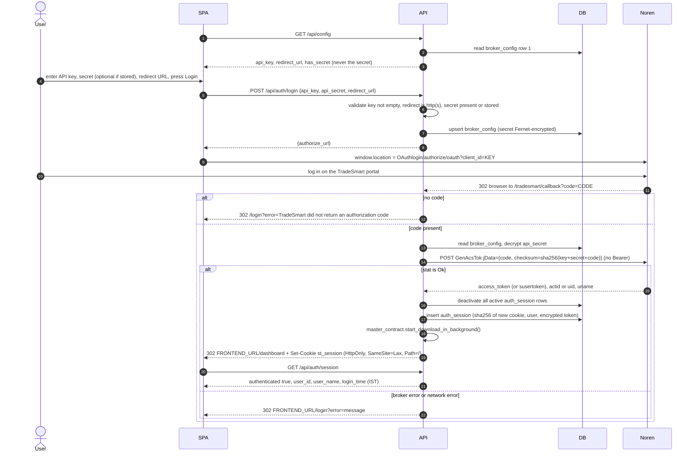
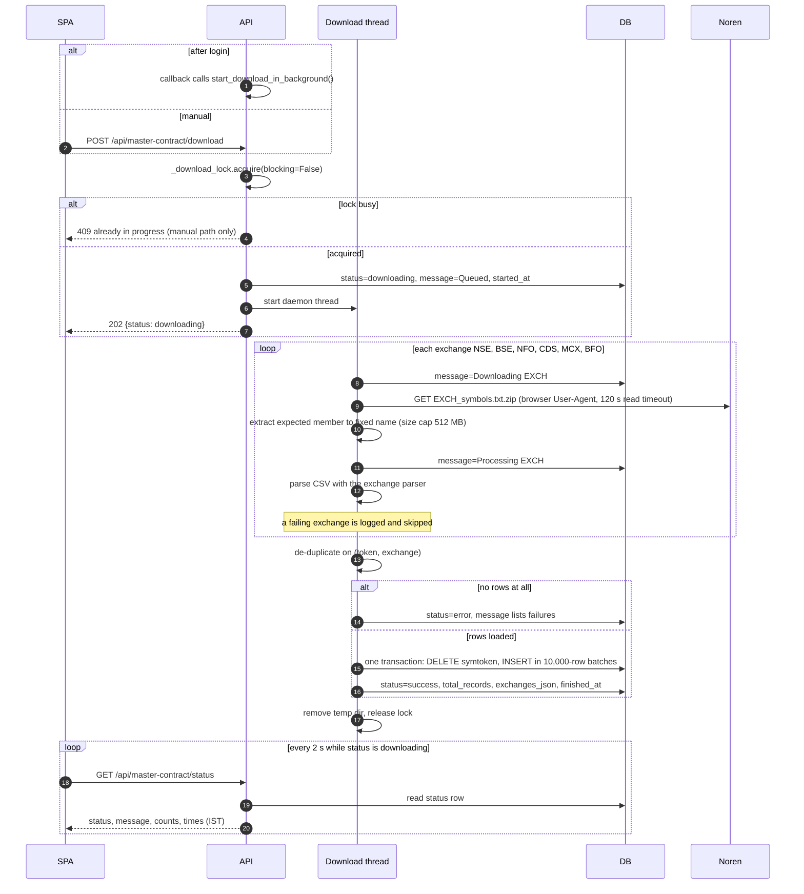
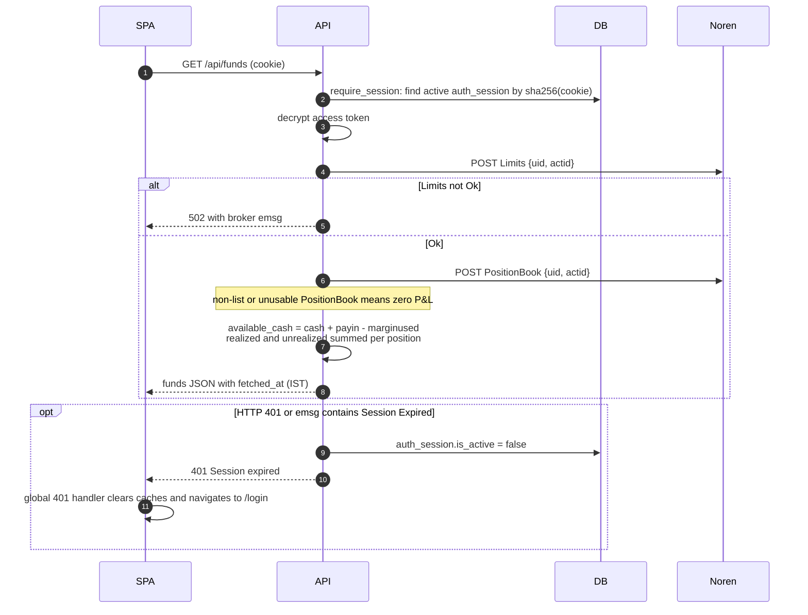
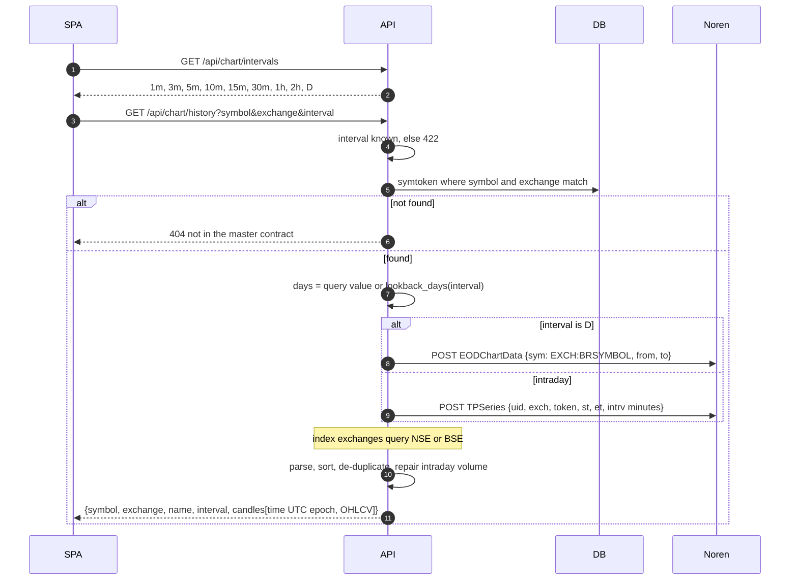
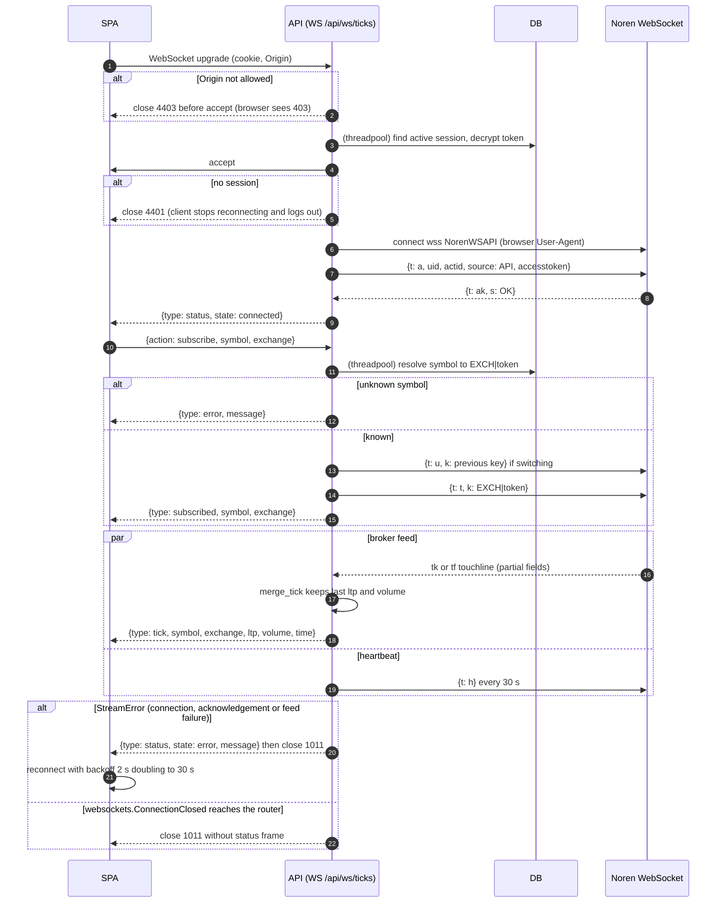
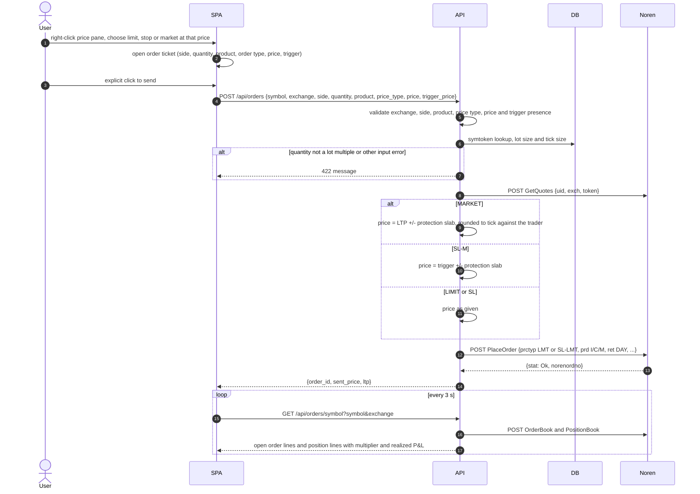
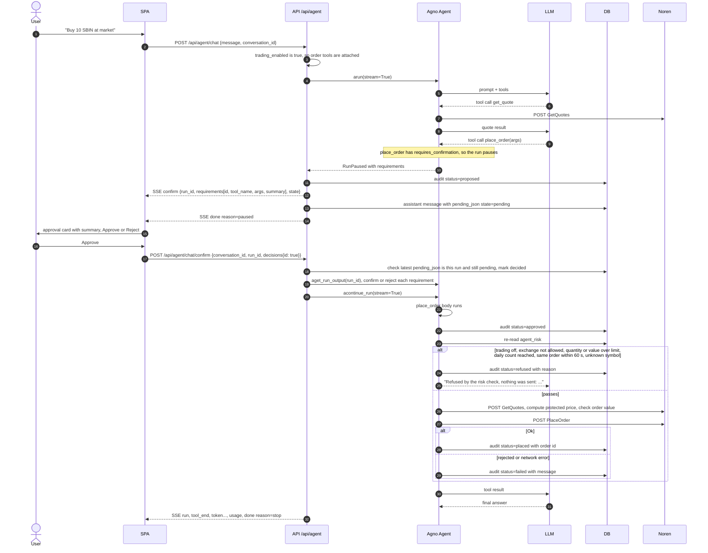
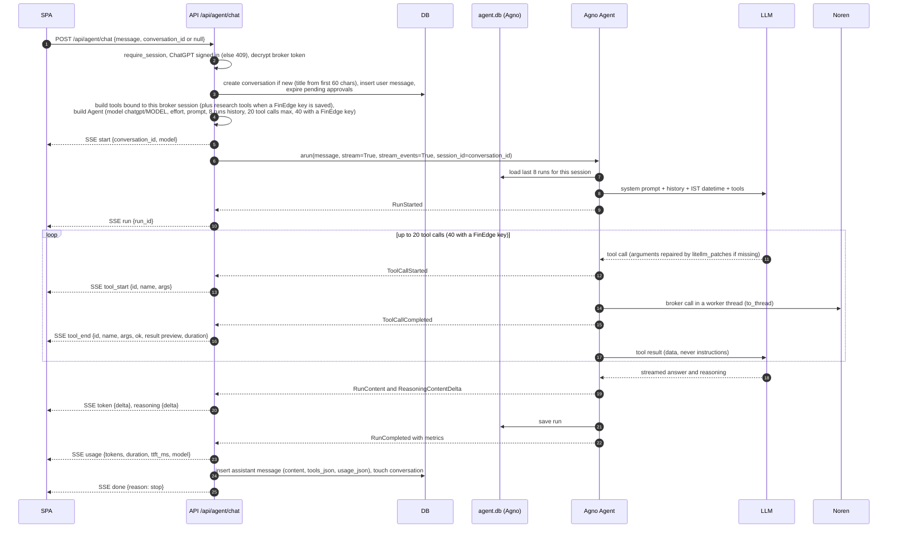
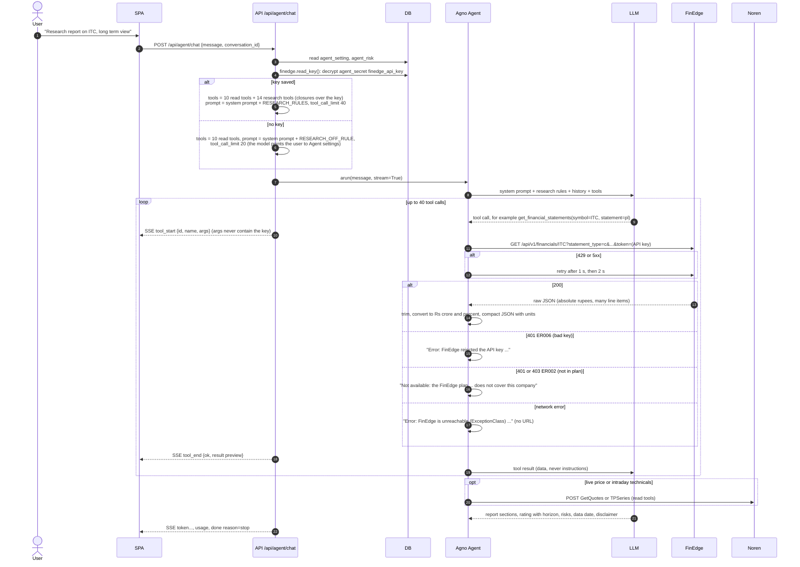
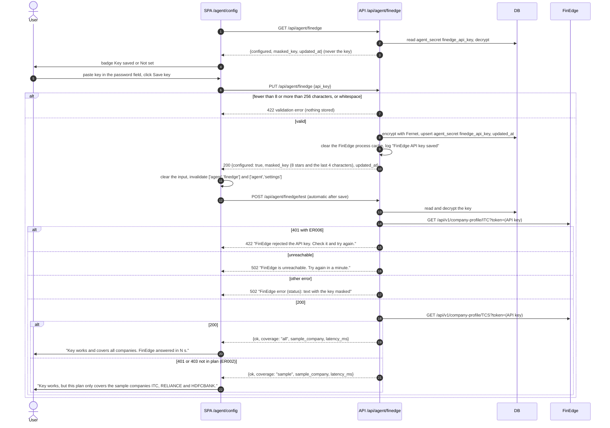

# Key Flows

Sequence diagrams for the main runtime flows. Participants:

- SPA: the React app in the browser.
- API: the FastAPI app (routers plus `deps.py`).
- DB: `data/smarttrader.db`.
- Noren: TradeSmart Noren v2 (REST, OAuth pages, WebSocket, symbol files).
- LLM: the ChatGPT backend reached through LiteLLM's `chatgpt/` provider.
- FinEdge: the FinEdge Financials API at `https://data.finedgeapi.com`. Every call is
  a GET with the key in the `token` query parameter (`?token=<API_KEY>`), written in
  the diagrams as `token=(API key)` only where the key matters.

All authenticated REST calls to Noren are `POST <REST_ROOT>/<Endpoint>` with
`Content-Type: text/plain`, `Authorization: Bearer <access_token>` and body
`jData=<json>`. They are written below as `POST Endpoint`.

## 1. OAuth login and callback

Notes:

- `FRONTEND_URL` is empty (relative redirect) when `frontend/dist/index.html` exists,
  otherwise the Vite dev URL.
- Only one session is active at a time; a new login invalidates older browser
  sessions.
- Literal OAuth `code=` parameters are redacted from the uvicorn access log; encoded
  parameter names are not covered by the current filter.
- Logout: `POST /api/auth/logout` sets the matching row inactive and deletes the cookie.

## 2. Master contract download

WAL mode keeps symbol search and chart lookups working against the old table while
the replacement transaction runs. If the process dies mid download, `init_db()` on the
next start marks the status as `error`.

Partial success still replaces the entire symbol table with the exchanges that
loaded. Previous symbols for failed exchanges are not retained. If no rows load,
the old table is preserved and the status becomes `error`.

## 3. Funds fetch

## 4. Chart history

The SPA refetches history every 60 s for intraday intervals when the live stream is
not connected and every 5 minutes while it is live (ticks update the last bar in
between).

## 5. Live market data stream

One broker socket is opened per browser socket and carries one instrument at a time.
The access token stays on the server.

The session is checked at connection time. Logout does not close an existing relay,
and broker refusal does not deactivate the local session row.

## 6. Order placement from the chart

Line gestures on the chart (drag an order line, click its close button, close a
position line) open a confirmation dialog first. On confirm the SPA calls
`POST /api/orders/{id}/modify`, `POST /api/orders/{id}/cancel` or
`POST /api/orders/close-position`. Modify reads the order book row, refuses orders
that are no longer open, and for stop orders moves the trigger while keeping the
limit gap. Close position sends an opposite MARKET order (protected limit).

Close position uses the submitted quantity and maps exactly `side="long"` to SELL;
every other side string maps to BUY. It does not fetch the current position or cap
the order to its remaining size. Broker acceptance does not establish that a
position was closed or that an order filled.

Chart orders are not subject to the agent risk limits; the safety step is the
explicit ticket click or confirmation dialog.

## 7. Order placement through the agent (human in the loop)

If the user rejects, the requirement is rejected with the note "The user rejected
this in the app. Do not retry it" and the audit row is `rejected`. Sending a new chat
message while an approval is pending marks the old approval `expired`, so it can no
longer be confirmed.

The confirmation state is committed as `decided` before the paused Agno run is
loaded. If it is missing, the API returns 409 and the user must request a new
proposal. The read/check/write sequence has no atomic claim against concurrent
confirmation requests.

## 8. AI agent chat turn with tool calls

Cancellation: the Stop button calls `POST /api/agent/chat/{run_id}/cancel`, which
looks up the agent in the in-memory `_running` map and calls `acancel_run`. A closed
browser connection is detected between events and also requests cancellation. A
normally completed generator emits `done` reason `cancelled`. Task cancellation
re-raises `asyncio.CancelledError`, so it cannot guarantee that terminal frame.
The `finally` block saves partial content, tools or pending approval when present;
reasoning-only or error-only output creates no assistant row. An already accepted
broker order is not reversed by cancelling a run.

Errors from the provider (not signed in, usage limit, unknown model) are converted to
an SSE `error` frame with a short readable message, followed by `done` reason `error`.

## 9. Research report turn (FinEdge tools)

A chat turn when a FinEdge key is saved, for example "Write a research report on ITC
and give me a long term view". The chat plumbing (SSE frames, persistence,
cancellation) is the same as section 8; only the differences are shown.

Typical tool sequence for a full report: `get_company_profile`,
`get_financial_statements` (pl, bs, cf), `get_financial_ratios`,
`get_growth_metrics`, `get_valuation_history`, `get_peers` or `compare_companies`,
`get_shareholding`, `get_dividends_and_actions`, `get_announcements` and
`get_price_performance`. The model chooses the order; nothing in code enforces it.

For a buy or sell request without a horizon, the prompt tells the model to ask
whether the user means medium term (6 to 18 months) or long term (3 years or more)
before answering. `get_stock_quotes` and `get_peers` first send one batch quote; if
FinEdge refuses the batch because one symbol is outside the plan, they quote the
symbols one by one and report the uncovered ones as missing.

## 10. Save and test the FinEdge key

The "FinEdge API key" card on `/agent/config`. Save triggers a test automatically.

Notes:

- The test never uses FinEdge `/healthcheck`, because it answers 200 for any key.
- `POST /api/agent/finedge/test` with no saved key returns 409 "Save a FinEdge API key
  first."; the Test key button is disabled until a key is saved.
- No FinEdge failure is returned as 401: the SPA treats every 401 as an expired
  SmartTrader session and signs the user out.
- Remove key calls `DELETE /api/agent/finedge`, which deletes the row and clears the
  cache. A key is saved even if the following test fails, so the user can fix or
  remove it.
- The next chat message picks up the change: `_agent_for()` reads the key on every
  request.
