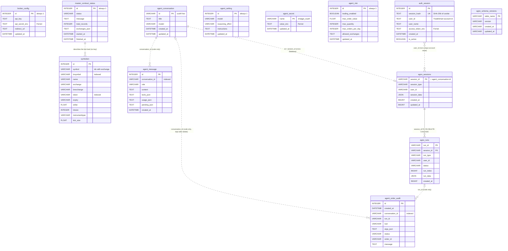

# SmartTrader data and schema

This folder documents every piece of data SmartTrader stores: the two SQLite
databases, the files next to them, and the in-code models that map onto them.
The code in `backend/app` is the source of truth. Where it differs from
`SPEC.md`, the code is documented and the difference is listed in
[risks-and-discrepancies.md](risks-and-discrepancies.md).

Schema facts below were checked against the SQLAlchemy models and installed
Agno library source (agno 3.1.2, pinned in `uv.lock`) on 2026-10-14. This is a
source audit: runtime databases, row counts and credentials were not inspected.
DDL describes a fresh database; an existing file may differ after upgrades.

## Contents

| File | What it covers |
| --- | --- |
| [README.md](README.md) | This overview: databases, ownership, connection settings, creation and migration, ER diagram |
| [core-tables.md](core-tables.md) | `broker_config`, `auth_session`, `symtoken`, `master_contract_status` |
| [agent-tables.md](agent-tables.md) | `agent_setting`, `agent_secret`, `agent_conversation`, `agent_message`, `agent_risk`, `agent_order_audit` |
| [agent-db.md](agent-db.md) | `agent.db`, the Agno session store: `agno_sessions`, `agno_runs`, `agno_schema_versions` |
| [files-and-formats.md](files-and-formats.md) | `secret.key` and Fernet encryption, master contract download format and parsing, temp files, WAL files, in-memory caches |
| [code-models.md](code-models.md) | SQLAlchemy ORM models, Pydantic request bodies, dataclasses, JSON column shapes |
| [risks-and-discrepancies.md](risks-and-discrepancies.md) | Schema risks and code vs SPEC.md differences |

## The two databases

All runtime data lives in `backend/data/` (`config.DATA_DIR`), created by
`config.ensure_data_dirs()` on startup. The folder is git-ignored
(`backend/.gitignore`).

| Database | Path | Owner (code) | Tables | Purpose |
| --- | --- | --- | --- | --- |
| `smarttrader.db` | `backend/data/smarttrader.db` (`config.DB_PATH`) | SmartTrader itself: engine in `app/db.py`, models in `app/models.py` | 10 | Broker credentials, login sessions, symbol master, download status, agent settings, ChatGPT tokens, chat transcript, risk limits, order audit |
| `agent.db` | `backend/data/agent.db` (`agent/builder.py:AGENT_DB_PATH`) | The Agno library (`agno.db.sqlite.SqliteDb`), opened by `agent/builder.py:agent_db` | 3 documented tables, created lazily | The model's own conversation memory: sessions and runs (full run payloads) used as chat history |

### Why two databases

The SmartTrader tables, including the UI transcript in `agent_message`, are
owned and shaped by SmartTrader. The model context (what the LLM sees as
history) is owned by Agno, which defines its tables and migration tooling. Keeping
Agno in a separate file means an Agno upgrade or migration never touches the
SmartTrader tables, and SmartTrader's `create_all` never sees Agno's tables.
The two are linked only by value: `agent_conversation.id` is used as the Agno
`session_id`.

## Connection settings

### smarttrader.db (`app/db.py`)

| Setting | Value | Where |
| --- | --- | --- |
| URL | `sqlite:///<backend>/data/smarttrader.db` built with `sqlalchemy.URL.create` | `db.py:engine` |
| `check_same_thread` | `False` (connections are used from FastAPI's thread pool and background threads) | `connect_args` |
| `timeout` | `30` seconds (sqlite3 driver busy wait) | `connect_args` |
| `PRAGMA journal_mode` | `WAL` (readers keep working while the master contract rewrite holds a write transaction) | `db.py:_sqlite_pragmas`, run on every new connection |
| `PRAGMA synchronous` | `NORMAL` (safe with WAL; the last commits may be lost on power failure, the file is not corrupted) | same |
| `PRAGMA busy_timeout` | `30000` ms | same |
| `PRAGMA foreign_keys` | not set (SQLite default off). No foreign keys are declared anyway. | |
| Session factory | `sessionmaker(bind=engine, autoflush=False, expire_on_commit=False)` as `SessionLocal` | `db.py` |
| Pool | SQLAlchemy default for a file SQLite database | |

Two access styles are used:

* Request-scoped sessions through `deps.py:get_db` (a FastAPI dependency that
  opens `SessionLocal()` and closes it after the request).
* Short explicit sessions `with SessionLocal() as db` or
  `with SessionLocal.begin() as db` in background threads, agent tools and
  streaming code (`broker/master_contract.py`, `agent/*.py`,
  `routers/agent.py`, `routers/stream.py`, `broker/order_service.py`).

SmartTrader does not set `page_size` or `user_version`.

### agent.db (Agno `SqliteDb`)

| Setting | Value | Where |
| --- | --- | --- |
| URL | `sqlite:///<backend>/data/agent.db` | `agent/builder.py:agent_db` passes `db_file`; Agno builds the engine |
| Instance | One `SqliteDb` per process (`functools.lru_cache(maxsize=1)`) | `agent/builder.py:agent_db` |
| `PRAGMA foreign_keys` | `ON` (so `agno_runs` rows cascade when a session is deleted) | Agno `SqliteDb.__init__` connect listener |
| `PRAGMA journal_mode` | `WAL` | same |
| `PRAGMA synchronous` | default (`FULL`) | same |
| Session factory | Agno's own `scoped_session(sessionmaker(...))` | Agno |

## Creation and migration strategy

There is no Alembic and no versioned migration for `smarttrader.db`.
The application does not use `PRAGMA user_version`. At application startup
(`main.py:lifespan`) the following runs:

1. `db.py:init_db`
   1. `config.ensure_data_dirs()` creates `data/` and `data/tmp/`.
   2. `Base.metadata.create_all(engine)` creates any table from
      `app/models.py` that does not exist yet, together with its indexes. It
      never alters an existing table and never adds a new index to an existing
      table.
   3. `db.py:_add_missing_columns()` applies the small hand-kept registry
      `_ADDED_COLUMNS`. Today it holds one entry: `agent_message.pending_json TEXT`.
      For each listed column missing from an existing table it runs
      `ALTER TABLE <table> ADD COLUMN <name> <type>`. On upgraded tables,
      `pending_json` therefore follows `created_at`; fresh tables follow model order.
   4. Seeds the singleton `master_contract_status` row (`id=1`, `status='idle'`,
      `total_records=0`, `exchanges_json='{}'`). If the row exists with
      `status='downloading'` (a previous process died mid download) it is set
      to `error` with the message "Previous download was interrupted".
2. `crypto.get_fernet()` loads `data/secret.key`, or creates it on first start.

Other singleton rows are created lazily the first time they are needed, not at
startup:

| Row | Created by |
| --- | --- |
| `broker_config` id=1 | `routers/auth.py:login` on the first Login |
| `agent_setting` id=1 | `routers/agent.py:_settings` on the first agent call |
| `agent_risk` id=1 | `agent/trading.py:risk_settings` on the first read |
| `agent_secret` name=`chatgpt_oauth` | `agent/chatgpt_auth.py:write_tokens` after ChatGPT sign-in |

`agent.db` tables are created by Agno on first use
(the first agent run that stores a session). Agno records the schema version
of each table it owns in `agno_schema_versions` (both tables at `3.0.0` with
agno 3.1.2). The adapter stamps newly created tables using
`MigrationManager.latest_schema_version`; it does not invoke `MigrationManager.up`.
SmartTrader has no automatic Agno upgrade migration step and never issues DDL
against `agent.db` directly. Existing databases need a separate migration review
when the library is upgraded.

To add a column to a SmartTrader table: add it to the model and, because
`create_all` will not alter an existing table, add it to `_ADDED_COLUMNS` in
`db.py`. Anything else (type change, new index on an existing table, rename,
constraint) has no automated path and must be done by hand.

## Conventions that apply to every SmartTrader table

* Timestamps are naive UTC from `config.utcnow()`. SQLAlchemy's `DateTime`
  stores them in SQLite as TEXT `YYYY-MM-DD HH:MM:SS.ffffff` (26 characters).
  The API converts them to IST ISO strings with `config.to_ist_iso`.
  Agno tables in `agent.db` use BIGINT epoch seconds instead.
* Booleans (`Boolean`) are stored as INTEGER 0 or 1. SQLAlchemy 2 does not emit
  a CHECK constraint for them in these models.
* Defaults declared in the models (`default=`) are applied by the ORM in
  Python. None of them is a database `DEFAULT` clause, so the DDL has no
  defaults. Raw SQL inserts must supply every NOT NULL column except a generated
  integer primary key.
* Integer primary keys declared with `autoincrement=True` are plain SQLite
  rowid aliases (no `AUTOINCREMENT` keyword), so a rowid can be reused after
  the highest rows are deleted. This matters for `symtoken`, whose ids restart
  at 1 after every full replacement.
* No foreign keys are declared. Relationships between tables are maintained
  by application code (see the ER diagram).
* JSON is stored as TEXT (`*_json` columns) and parsed with `json.loads` in
  the routers.
* Encrypted columns end in `_enc` and hold a Fernet token (see
  [files-and-formats.md](files-and-formats.md#encryption-at-rest)).

## ER diagram

Solid lines are relationships enforced by a real foreign key. Dashed lines are
logical relationships kept by application code only (no constraint). The
`agno_*` entities live in `agent.db`; everything else lives in
`smarttrader.db`. Agno entities show selected columns; [agent-db.md](agent-db.md)
lists their full schemas. Singleton tables have no key relationships.

## Where data flows, in one paragraph

Login (`routers/auth.py`) writes `broker_config` and, on the OAuth callback,
deactivates every active `auth_session` and inserts a new one, then starts
the master contract download, which rewrites `symtoken` in one transaction
and reports progress in `master_contract_status`. Every authenticated route
resolves the `st_session` cookie to an active `auth_session` row by hash.
Routes that need broker credentials separately decrypt the access token.
Symbol lookups for charts, ticks, orders and
the agent read `symtoken`. The agent reads `agent_setting`, `agent_risk` and
`agent_secret`, writes the visible transcript into `agent_conversation` and
`agent_message`, appends to `agent_order_audit` for every order proposal and
outcome, and lets Agno persist model history to `agent.db`. Funds, quotes,
history, positions, orders and holdings are fetched live rather than from a
local broker-data cache. Agent tool results and assistant replies can persist
that data in plaintext in both transcript stores; agent order details also
persist in the audit. Agent tables are global to the installation, with no
account ownership column or per-account filtering on conversations or audits.
